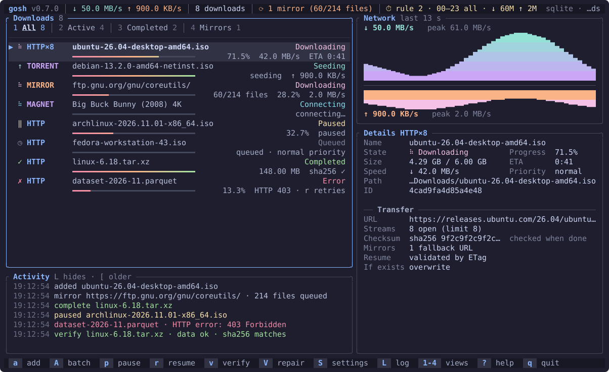
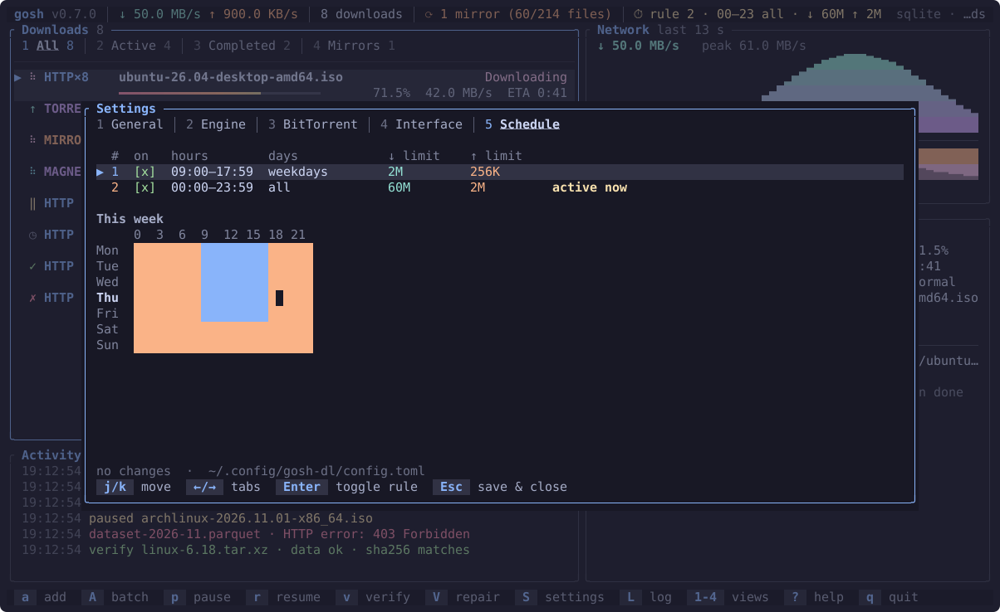
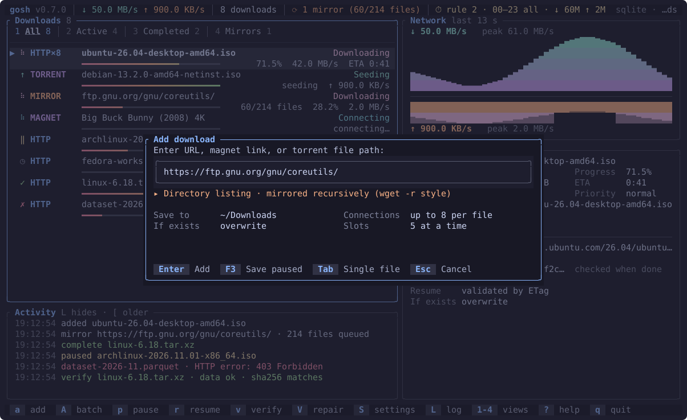
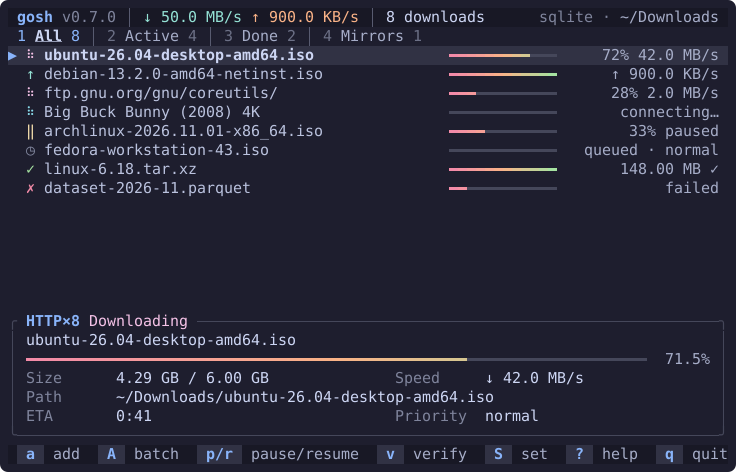

# gosh-dl-cli

[](https://crates.io/crates/gosh-dl-cli)
[](https://docs.rs/gosh-dl/latest/gosh_dl/)
[](https://github.com/goshitsarch-eng/gosh-dl-cli/actions/workflows/ci.yml)
[](LICENSE)

A download manager for the terminal. HTTP/HTTPS with multi-connection acceleration, full BitTorrent support, and an optional TUI. Built on [gosh-dl](https://github.com/goshitsarch-eng/gosh-dl).

## Features

- **HTTP/HTTPS downloads** with multi-connection acceleration, resume, retries, fallback mirrors (`--alt-url`), Metalink files, checksum verification, and speed limits
- **Full BitTorrent support** -- torrents and magnet links with DHT, PEX, LPD, sequential mode, file selection, and seed ratio control
- **Recursive HTTP mirroring** (`gosh mirror`, or a directory URL in the TUI) -- crawl a directory listing and download everything under it, wget -r style, with depth limits, include/exclude globs, dry-run previews, and saved mirror jobs for later resume
- **Three usage modes** -- aria2-style direct downloads with progress bars, a full-screen TUI, and scriptable subcommands with JSON output
- **No silent overwrites** -- choose what happens when a finished download's name is already taken: `overwrite`, `rename` (`file (1).iso`), or `fail`
- **Integrity checks** -- `gosh verify` / `gosh repair` (and `v` / `V` in the TUI) check the data on disk and re-download what is damaged
- **Batch operations** -- `pause-all`, `resume-all`, and `cancel-all` (CLI and TUI) with per-download outcome reporting
- **Interactive TUI** -- tabbed download list with mirrors as single rows, network graph, details panel, activity log, search, settings editor with a weekly schedule map, and batch URL import
- **Persistent queue** -- downloads survive restarts via SQLite (default), aria2-style JSON sidecar files, or no persistence at all (`storage_backend`)
- **Bandwidth scheduling** -- time-of-day and day-of-week speed limit rules, toggled from the TUI
- Cross-platform: Linux, macOS, and Windows

### What's new in 0.7.0

- **gosh-dl 0.7.0 engine**: capability probes fall back from `HEAD` to a ranged
  `GET`, so pre-signed URLs (S3 and friends) download and resume; single-stream
  downloads retry; many torrent and resume fixes.
- **Conflict policy**: `--on-conflict overwrite|rename|fail` and
  `general.file_conflict`. The default is still `overwrite`.
- **New commands**: `gosh verify <ID>` and `gosh repair <ID>`.
- **New inputs**: Metalink files (`.meta4`, `.metalink`) and `--alt-url`
  fallback mirrors.
- **Redesigned TUI**: tabs (All / Active / Completed / Mirrors), one row per
  mirror job, a mirrored up/down network graph, a details panel per kind of
  download, a verify dialog, "save paused", and a schedule tab with a week map.
- `--max-retries` now means retries *after* the first attempt; `0` tries once.
- Rust 1.89 or newer is required.

See [CHANGELOG.md](CHANGELOG.md) and [ROLLOUT.md](ROLLOUT.md) for details.

## Screenshots



| Schedule tab | Adding a directory URL | 80x24 terminal |
| --- | --- | --- |
|  |  |  |

The screenshots are rendered from the real drawing code with sample data:
`GOSH_SCREENSHOT_DIR=screenshots cargo test screenshot -- --ignored`.

## Install

From crates.io (requires Rust 1.89+):

```bash
cargo install gosh-dl-cli --locked
```

Without the TUI (smaller binary, fewer dependencies):

```bash
cargo install gosh-dl-cli --locked --no-default-features
```

From source:

```bash
git clone https://github.com/goshitsarch-eng/gosh-dl-cli
cd gosh-dl-cli
cargo build --release --locked
cp target/release/gosh ~/.local/bin/   # or /usr/local/bin/
```

Pre-built binaries for Linux (static musl), macOS, and Windows, each for
x86_64 and ARM64, are attached to
[GitHub Releases](https://github.com/goshitsarch-eng/gosh-dl-cli/releases)
together with a `SHA256SUMS` file.

## Quick start

Download a file:

```bash
gosh https://example.com/file.zip
```

Download to a specific directory with a custom filename:

```bash
gosh -d ~/Downloads -o archive.zip https://example.com/file.zip
```

Multiple files at once:

```bash
gosh https://example.com/a.zip https://example.com/b.zip
```

Torrents and magnet links work the same way:

```bash
gosh magnet:?xt=urn:btih:...
gosh ./ubuntu.torrent
```

Mirror an HTTP directory listing recursively (wget -r style):

```bash
gosh mirror https://ftp.gnu.org/gnu/hello/
```

Keep an existing file instead of overwriting it, and name a fallback mirror:

```bash
gosh --on-conflict rename https://example.com/report.pdf
gosh --alt-url https://mirror.example.org/big.iso https://example.com/big.iso
```

Download everything a Metalink file lists, with its mirrors and checksums:

```bash
gosh ./release.meta4
```

Launch the interactive TUI by running `gosh` with no arguments.

## Usage modes

gosh has three modes:

**Direct mode** -- pass URLs as arguments and downloads start immediately with progress bars. This is the aria2-style workflow most people want.

**TUI mode** -- run `gosh` with no arguments for a full-screen terminal interface. You can add, pause, resume, and monitor downloads interactively.

**Command mode** -- use subcommands (`gosh add`, `gosh list`, etc.) for scripting and automation.

`gosh` has no daemon or IPC service. Use one process per storage location:
subcommands operate on saved state and do not control another running TUI or
CLI process. For background transfers, keep a foreground command running in
a terminal multiplexer or a service manager. `--enqueue` (formerly described
as `--detach`) saves a paused mirror; it does not leave a worker running.

Ctrl+C in direct downloads, `add --wait`, `resume`, and foreground mirrors
pauses unfinished work and exits with code 130. With SQLite or file storage,
use `gosh resume all` or the TUI to continue. With `storage_backend = "none"`,
no state survives exit, so queue-only commands are rejected.

## CLI reference

### Global options

These work with any mode or subcommand:

| Flag | Description |
|------|-------------|
| `-c, --config <PATH>` | Config file path (env: `GOSH_CONFIG`) |
| `-v, --verbose` | Increase log verbosity (`-v`, `-vv`, `-vvv`) |
| `-q, --quiet` | Suppress output except errors |
| `--output <FORMAT>` | Output format: `table`, `json`, `json-pretty` |
| `--color <WHEN>` | Color output: `auto`, `always`, `never` |
| `--proxy <URL>` | Proxy URL (`http://`, `https://`, `socks5://`) |
| `--max-retries <N>` | Retries after a failed HTTP attempt; `0` tries once (default: 3) |
| `--on-conflict <POLICY>` | When a finished HTTP download's name is taken: `overwrite` (default), `rename`, `fail` |

### Direct mode options

Used when passing URLs directly (`gosh [OPTIONS] <URL>...`):

| Flag | Description |
|------|-------------|
| `-d, --dir <PATH>` | Output directory |
| `-o, --out <NAME>` | Output filename (single download only) |
| `-x, --max-connections <N>` | Connections per download (default: 8) |
| `--max-speed <SPEED>` | Speed limit (supports `K`/`M`/`G` suffixes) |
| `-H, --header <HEADER>` | Custom header (`"Name: Value"`) |
| `--user-agent <UA>` | User agent string |
| `--referer <URL>` | Referer URL |
| `--cookie <COOKIE>` | Cookie (`"name=value"`) |
| `--checksum <HASH>` | Verify checksum (`md5:...` or `sha256:...`) |
| `--alt-url <URL>` | Fallback URL serving the same file (repeatable; one HTTP download only) |
| `--sequential` | Download pieces in order (torrents) |
| `--select-files <IDX>` | Download specific files (comma-separated, torrents) |
| `--seed-ratio <RATIO>` | Stop seeding after this ratio (torrents) |
| `--no-dht` | Disable DHT |
| `--no-pex` | Disable Peer Exchange |
| `--no-lpd` | Disable Local Peer Discovery |
| `--max-peers <N>` | Max peers per torrent |

### Subcommands

**`gosh add <URL>...`** -- Save downloads paused for later resume. Accepts URLs,
magnet links, `.torrent` files and Metalink files (`.meta4`, `.metalink`). Use `--wait`
to download now and wait for completion. Saving without `--wait` requires
SQLite or file storage.

Accepts all the direct mode options above, plus:

| Flag | Description |
|------|-------------|
| `-p, --priority <LEVEL>` | `low`, `normal`, `high`, `critical` |
| `-w, --wait` | Download in the foreground and return its success/failure exit code |
| `-i, --input-file <FILE>` | Read URLs from a file (one per line) |

**`gosh list`** -- List all downloads.

| Flag | Description |
|------|-------------|
| `-s, --state <STATE>` | Filter: `active`, `waiting`, `paused`, `completed`, `error` |
| `--ids-only` | Print only download IDs |

**`gosh status <ID>`** -- Show detailed status of a download.

| Flag | Description |
|------|-------------|
| `--peers` | Show peer info (torrents) |
| `--files` | Show file list (torrents) |

**`gosh pause <ID>...`** -- Pause downloads. Use `all` to pause everything.

**`gosh resume <ID>...`** -- Resume paused downloads and wait for completion. Use `all` to resume everything.

**`gosh cancel <ID>...`** -- Cancel downloads.

| Flag | Description |
|------|-------------|
| `--delete` | Also delete downloaded files |
| `-y, --yes` | Skip confirmation |

**`gosh pause-all`** / **`gosh resume-all`** / **`gosh cancel-all`** -- Batch operations across saved downloads, reporting per-download outcomes (succeeded / skipped / failed). `resume-all` remains in the foreground until the resumed downloads finish.

| Flag (`cancel-all`) | Description |
|------|-------------|
| `--delete-files` | Also delete downloaded files |
| `-y, --yes` | Skip confirmation |

> **Note:** as of gosh-dl 0.5.0, pausing also holds *queued* downloads, so `pause all` / `pause-all` freezes the whole queue instead of letting waiting downloads get promoted into freed slots.

**`gosh mirror <URL>`** -- Recursively mirror an HTTP/HTTPS directory listing (like `wget -r`). See [Mirroring](#mirroring-recursive-http) below.

**`gosh priority <ID> <LEVEL>`** -- Set download priority (`low`, `normal`, `high`, `critical`).

**`gosh verify <ID>`** -- Check a download's data on disk. Torrents re-hash
every piece; HTTP downloads are checked against their size and, when one was
given, their checksum. Exits `0` when the data is valid and `1` when it is not.

**`gosh repair <ID>`** -- Verify, and when the data is bad, download the
damaged part again in the foreground. Pause an active download before
verifying or repairing it.

**`gosh stats`** -- Show global download/upload statistics.

**`gosh info <FILE>`** -- Parse and display torrent file metadata.

**`gosh config <ACTION>`** -- Manage configuration: `show`, `path`, `get <KEY>`, `set <KEY> <VALUE>`.

**`gosh completions <SHELL>`** -- Generate shell completions for `bash`, `zsh`, `fish`, `elvish`, or `powershell`. Pipe the output to the appropriate completions directory for your shell.

## Mirroring (recursive HTTP)

`gosh mirror` crawls a directory-listing page and downloads every file it discovers, preserving the remote directory structure locally:

```bash
# Mirror a directory tree
gosh mirror https://ftp.gnu.org/gnu/hello/

# Preview what would be downloaded without downloading anything
gosh mirror --dry-run --depth 2 https://ftp.gnu.org/gnu/hello/

# Only .iso and .sig files, two levels deep, into ~/mirrors
gosh mirror -d ~/mirrors --depth 2 --include '*.iso' --include '*.sig' \
    https://example.com/releases/

# Save the mirror paused for later resume
gosh mirror --enqueue https://example.com/files/
gosh mirror list
gosh mirror status <ID>
gosh mirror cancel <ID>
gosh mirror remove <ID> --delete-files
```

| Flag | Description |
|------|-------------|
| `-d, --dir <PATH>` | Output directory (root of the mirrored tree) |
| `--depth <N>` | Maximum traversal depth (default: 16) |
| `--include <GLOB>` | Only download matching files (repeatable) |
| `--exclude <GLOB>` | Skip matching files (repeatable) |
| `--prefix <PREFIX>` | Restrict discovered URLs to a path prefix |
| `--span-hosts` | Follow links to other hosts (off by default) |
| `--flatten` | Put all files in one directory instead of preserving paths |
| `--overwrite` | Overwrite existing local files |
| `--fail-fast` | Abort remaining files after the first failure |
| `--discovery-concurrency <N>` | Concurrent page-fetch requests (default: 4) |
| `--dry-run` | Discover and list files without downloading |
| `--enqueue` (alias `--detach`) | Save the mirror paused for later resume; requires persistence |

HTTP options from direct mode (`-H`, `--user-agent`, `--referer`, `--cookie`, `-x`, `--max-speed`) also apply to each mirrored file. Overall download parallelism is governed by `engine.max_concurrent_downloads` in the config; `--discovery-concurrency` only affects the page crawl.

Mirror exit codes follow the standard table below: `0` all files completed, `1` some failed, `2` all failed, `130` interrupted.

## TUI

Run `gosh` with no arguments.

```
 gosh v0.7.0 │ ↓ 50.0 MB/s ↑ 900 KB/s │ 8 downloads │ ⟳ 1 mirror (60/214 files) │ ⏱ rule 1 · 09–17 weekdays · ↓ 2M ↑ 256K
╭ Downloads 8 ─────────────────────────────────────╮╭ Network last 13 s ───────────╮
│ 1 All 8 │ 2 Active 4 │ 3 Completed 2 │ 4 Mirrors 1││ ↓ 50.0 MB/s   peak 61.0 MB/s │
│▶ ⠷ HTTP×8   ubuntu-26.04-desktop.iso  Downloading ││      ▂▅▇████▇▅▃              │
│             ━━━━━━━━━━━   71.5%  42 MB/s  ETA 0:41││ ──────────────────────────── │
│  ⠷ MIRROR   ftp.gnu.org/gnu/coreutils/ Downloading│╰──────────────────────────────╯
│             ━━━━        60/214 files  28%  2 MB/s │╭ Details HTTP×8 ──────────────╮
╰──────────────────────────────────────────────────╯│ Name   ubuntu-26.04-desktop… │
╭ Activity L hides ────────────────────────────────╮│ State  ⠷ Downloading         │
│ 19:05:07 complete linux-6.18.tar.xz              ││ ── Transfer ──────────────── │
╰──────────────────────────────────────────────────╯╰──────────────────────────────╯
  a  add   A  batch   p  pause   r  resume   v  verify   S  settings   ?  help   q  quit
```

At 100x24 and larger the screen has four panels: the download list, an
activity log, a network graph, and details of the selected row. Smaller
terminals (down to 60x12) get one-line rows above a short details box, and
anything smaller shows just the list.

**Rows.** Every download is one row with a kind tag (`HTTP×8` while eight
connections are open, `TORRENT`, `MAGNET`). A recursive mirror is a *single*
`MIRROR` row standing for all of its files; pause, resume and cancel act on
the whole job, and the details panel lists its files. Tabs `1`-`4` switch
between All, Active, Completed and Mirrors.

**Adding.** `a` accepts a URL, a magnet link, or the path of a `.torrent` or
Metalink file, and says what it recognised as you type. A URL ending in `/` is
mirrored recursively; `Tab` switches it to a single download. `Enter` starts
it, `F3` (or `Shift+Enter` where the terminal reports it) saves it paused.
Mirror discovery runs in the background, so the interface stays responsive
while a large tree is crawled. `A` imports a pasted list.

**Details.** HTTP downloads show their open connections, checksum, fallback
mirrors and how a resume is validated; torrents show peer discovery, the
swarm, and their files. The engine reports no per-connection or per-piece
telemetry, so the panel shows totals rather than an invented piece map.

| Key | Action |
|-----|--------|
| `a` | Add a download (`F3` saves it paused, `Tab` toggles mirror / single file) |
| `A` | Batch import (`F2` reviews the list, `Enter` imports the selected lines) |
| `p` / `r` | Pause / resume (or retry) the selected row |
| `v` | Verify the selected download's data on disk |
| `V` | Verify and repair it (asks first) |
| `c` / `d` | Cancel and keep the files / cancel and delete them |
| `P` / `R` / `C` | Pause all / resume all / cancel all (asks first) |
| `1`-`4`, `Tab` | Views: All, Active, Completed, Mirrors |
| `/` | Filter the list (`Tab` cycles the scope, `Enter` keeps it, `Esc` clears) |
| `S` | Settings and schedule; `Esc` saves and closes |
| `L`, `[` / `]` | Show or hide the activity log; scroll it |
| `j` / `k`, arrows, PgUp / PgDn, Home / End | Move |
| `J` / `K` | Move the row down / up in the list (display order only, not priority) |
| `?` or `F1` | Help |
| `q` or Ctrl+C | Quit (Ctrl+C works inside dialogs too) |

**Verify and repair.** Pause an active download first. `v` opens a dialog that
shows the result when the check finishes; closing it lets the check continue
in the background and reports the result as a notification and in the activity
log. HTTP verification uses the stored checksum when there is one, otherwise
presence and size only (same-size corruption is then undetectable). Repair
removes corrupt HTTP data and restarts it, or queues missing and bad torrent
pieces. Mirrored files are verified one at a time with `gosh verify <ID>`.

**Settings.** Five tabs: General, Engine, BitTorrent, Interface, Schedule.
The rows are the same keys `gosh config set` takes, and accept the same values
(`2M`, `512K`, empty for unlimited). Settings marked `↻` (storage, logging,
proxy, timeouts) take effect the next time gosh starts; everything else,
including the conflict policy, concurrency and speed limits, applies
immediately. An invalid value is rejected and never half-applied; a failed
save keeps your draft. The Schedule tab lists the rules, shows which one is in
force for every hour of the week, and toggles a rule with `Enter`. Rules are
added and edited in the config file.

Foreground torrent commands wait through seeding until the configured seed ratio
is reached. The engine treats `--seed-ratio 0` as unlimited seeding; use Ctrl+C
to pause and exit. The TUI continues running while torrents seed.

Logs use `general.log_level` unless overridden by `-v`, `--quiet`, or `RUST_LOG`.
Set `general.log_file` to retain diagnostics. The TUI suppresses console logs so
they cannot overwrite the interface; command mode logs go to stderr by default.

## Configuration

Config file location: `~/.config/gosh-dl/config.toml`

Override the path with `-c <PATH>` or the `GOSH_CONFIG` environment variable.

```toml
[general]
download_dir = "~/Downloads"
log_level = "info"                      # overridden by -v / --quiet / RUST_LOG
# log_file = "/path/to/gosh.log"         # optional; useful for TUI diagnostics
storage_backend = "sqlite"              # sqlite (default), file (JSON sidecars), none
file_conflict = "overwrite"             # overwrite (default), rename ("name (1).ext"), fail

[engine]
max_concurrent_downloads = 5
max_connections_per_download = 8
global_download_limit = 0               # bytes/sec, 0 = unlimited
global_upload_limit = 0
max_retries = 3                         # retries after the first attempt; 0 = try once
connect_timeout = 30                    # seconds
read_timeout = 60

# BitTorrent
enable_dht = true
enable_pex = true
enable_lpd = true
max_peers = 55
seed_ratio = 1.0

# Proxy (overridden by --proxy flag or env vars)
# proxy_url = "socks5://127.0.0.1:1080"

# TLS (dangerous -- prefer --insecure flag for one-off use)
# accept_invalid_certs = false

[tui]
refresh_rate_ms = 250
theme = "dark"                          # "dark", "light" or "macchiato"
show_speed_graph = true
show_peers = true

# Bandwidth scheduling -- rules are evaluated in order, first match wins
# [[schedule.rules]]
# start_hour = 9
# end_hour = 17
# days = "weekdays"                     # "all", "weekdays", "weekends", or "mon,tue,..."
# download_limit = "2M"                 # K/M/G suffixes
# upload_limit = "512K"
# enabled = true                        # false keeps the rule but switches it off
```

Every key can be read and written from the command line, for example
`gosh config set general.file_conflict rename` or
`gosh config set engine.global_download_limit 2M` (`unlimited` clears a limit).

## Environment variables

| Variable | Description |
|----------|-------------|
| `GOSH_CONFIG` | Custom config file path |
| `NO_COLOR` | Disable colored output (any value) |
| `HTTPS_PROXY` | HTTPS proxy URL |
| `HTTP_PROXY` | HTTP proxy URL |
| `ALL_PROXY` | Fallback proxy URL |
| `RUST_LOG` | Override log level filter |

Proxy precedence: `--proxy` flag > config file > `HTTPS_PROXY` > `HTTP_PROXY` > `ALL_PROXY`.

## Exit codes

| Code | Meaning |
|------|---------|
| 0 | Command succeeded; foreground downloads completed, or queue-only work was saved |
| 1 | Some downloads failed, or configuration/command validation failed |
| 2 | All monitored downloads failed, or argument parsing failed |
| 130 | Interrupted (Ctrl+C); unfinished work paused for resume when persistence is enabled |

## Building from source

```bash
cargo build --locked            # debug build
cargo build --locked --release  # optimized (LTO + stripped)
cargo test --locked             # run tests
cargo build --locked --no-default-features --release   # without TUI
```

Release builds use thin LTO, symbol stripping, and single codegen unit for smaller binaries.
The tests start HTTP servers on loopback only; they need no network access.

## Continuous integration and releasing

Every push to `main` and every pull request runs
[`ci.yml`](.github/workflows/ci.yml): formatting, Clippy, the minimum Rust
version (1.89), `cargo package`, tests with and without the TUI on Linux,
macOS and Windows, and release builds of the six binaries (Linux musl, macOS
and Windows, each for x86_64 and ARM64).

To release a version:

1. Set the version in `Cargo.toml`, add its section to `CHANGELOG.md`, and
   merge to `main`.
2. Tag it and push the tag: `git tag v0.7.0 && git push origin v0.7.0`.
   [`release.yml`](.github/workflows/release.yml) reruns CI, then creates the
   GitHub release with the six archives, `SHA256SUMS`, and the changelog
   section as release notes. It refuses a tag that does not match
   `Cargo.toml`.
3. Publish the crate: `cargo publish --locked`. This step is deliberately
   manual; no registry token is stored in the repository.

## License

MIT -- see [LICENSE](LICENSE).
